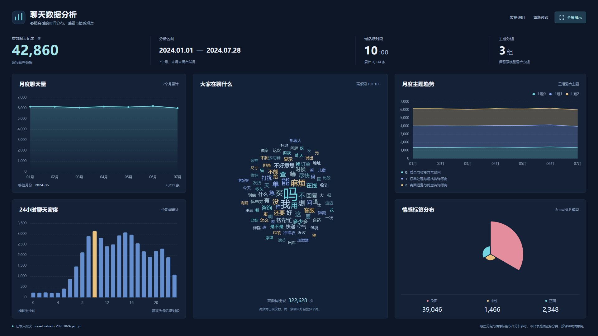

# Dify智能客服与聊天数据分析

微信客服、Dify工作流、MCP参数化写库、离线文本分析和Vue源码大屏的完整项目源码。此仓库为整理后的源码版本，运行凭据、聊天原文、虚拟机、模型权重和第三方安装包保留在原部署机器。



## 整个链路

1. Windows开发端与openEuler虚拟机提供Python、MySQL、Docker/Compose运行环境；Dify使用1.8.0版本。`deploy/`保存项目自有准备脚本与建表SQL。
2. Dify配置Qwen模型、本地Xinference、SiliconFlow向量/精排模型，以及`wechat-mysql`原生MCP工具。六节点RAG模板保存于`services/customer_assistant_workflow.yml`。
3. 两份热水器资料用于知识库与客服规则。Firecrawl抓取网页，经工作流整理，按原文档ID更新知识库；重复内容跳过。
4. 微信消息进入`services/wechat_public_bot.py`，校验签名、处理重复投递与近期上下文。个人号采用direct被动回复，不能依赖无权限的客服消息接口延后发送。
5. 当前快速业务工作流由`scripts/configure_wechat_fast.py`的`build_graph()`定义：开始 → 从MD读明确参数 → 条件分支 → 语言模型或参数回复 → 汇合 → 固定SQL及JSON参数 → MCP → 结束。共8个节点，参数分支可跳过LLM；六节点RAG模板作为独立历史方案保留。
6. MCP服务`services/mysql_server.py`只接受固定INSERT模板及两个字符串参数，通过PyMySQL参数绑定写入`wechat.chathistory`。先回复、后写库时，回复状态与数据库终态分别记录。
7. 离线分析`analysis/run_analysis.py`通过只读账号取数：空值/空白/无效日期检查 → jieba分词 → gensim LDA三主题 → SnowNLP情感 → 五份聚合CSV与manifest。预置数据与自采数据分别建批次，不混算。
8. `scripts/export_source_dashboard.py`核验CSV哈希、主键、月份、计数及总量，再导出`dashboard/public/data/dashboard.json`。Vue 3 + Vite + ECharts 5 + echarts-wordcloud 2绘制五图。
9. 当前展示批次为2024-01-01至2024-07-28，有效42,860条；上传源码前已完成两批聚合导出核验、图表测试、构建和桌面/窄屏浏览器检查。原魔方低代码看板作为旧展示版本保留；本仓库提供源码展示层。

## 先运行源码大屏

安装Node.js 24（自带npm），用VS Code打开`dashboard/聊天数据大屏.code-workspace`。在其终端运行：

```powershell
.\start.cmd
```

首次启动会安装依赖，浏览器访问 http://127.0.0.1:5173/ 。不需要Dify、虚拟机或数据库在线。其他系统可在`dashboard`目录执行`npm install`和`npm run dev`。

```powershell
.\start.cmd test
.\start.cmd build
.\start.cmd preview
```

构建结果在`dashboard/dist`，预览端口4173。详细说明见[大屏README](dashboard/README.md)。

## Python环境与数据导出

原项目使用Python 3.10.9；锁文件来自该环境，不承诺任意Python版本兼容。在新克隆目录中：

```powershell
py -3.10 -m venv .venv
.\.venv\Scripts\python.exe -m pip install -r requirements-lock.txt
Copy-Item .env.example .env
```

仅在新克隆且没有`.env`时复制示例，随后自行填写实际配置。原环境已存在的配置不要覆盖。

无需数据库即可重新导出仓库内已有聚合批次，导出工具只依赖Python标准库：

```powershell
python scripts/export_source_dashboard.py
python tests/check_source_dashboard_export.py
```

导出后开发页面点击“重新读取”；生产版本需重新构建。切换到原81,636条批次的方法见大屏README。

## 接入微信与Dify

先自行部署官方Dify 1.8.0和MySQL，配置模型、知识库、MCP和应用密钥，再填写本机`.env`。仓库不携带第三方Dify源码、容器数据、安装器或模型权重；Dify部署目录应从[官方1.8.0标签](https://github.com/langgenius/dify/tree/1.8.0/docker)取得。

```powershell
.\.venv\Scripts\python.exe services/mysql_server.py
$env:WECHAT_REPLY_MODE='direct'
.\.venv\Scripts\python.exe services/wechat_public_bot.py --env-file .env --host 127.0.0.1 --port 8081
```

微信回调需要可达的HTTPS域名，在公众号后台配置URL、Token和消息模式。临时隧道域名会变化，历史地址不作为有效配置。具体边界见[服务运行说明](services/README.md)。

本机运维脚本保留了原内网地址、资源ID、VMware路径和版本校验，许多脚本还会创建或更改真实资源。**先审阅源码并按自己的部署修改，不能把全部scripts或deploy脚本依次自动执行。** 静态YAML需选择自己的知识库和模型、填写secret环境变量；快速8节点方案在Python构图代码中，不等同于历史六节点YAML。

## 分析与核验

- 数据分析入口：`analysis/run_analysis.py`、`notebooks/项目数据分析.ipynb`。Notebook上传副本已清空输出与执行计数，克隆后需自行运行；原执行输出保留在本机。
- 无在线服务的回归：`python -m unittest discover -s tests -p "test_wechat*.py"`、`python -m unittest discover -s tests -p "test_mysql_server.py"`、`python -m unittest discover -s tests -p "test_analysis.py"`。
- `tests/test_vm_install_config.py`检查本机VM配置，需要未上传的VM文件；情感人工复核脚本也可能需要私有逐条材料或原Excel。此类部署验收不能直接当成新克隆的通用单元测试。
- `scripts/verify_*.py`多为真实服务验收，可能写入合成测试记录再清理；先配置环境并阅读脚本，不能与mock测试混为一谈。

## 数据与结果边界

- 当前批次原始44,228条、排除1,368条、有效42,860条。仓库只保留五份聚合CSV和manifest；原始聊天不上传。
- 这是离线预置分析快照，微信新消息不会自动刷新大屏。2024年7月仅至28日，不能按完整自然月比较。
- 三主题保留混合分组，0偏“质量与收货异常”、1偏“订单处理与规格咨询”、2偏“寄回运费与优惠”。编号和倾向不等于准确业务分类。
- SnowNLP标签为负面39,046、中性1,466、正面2,348，不能当作投诉率或满意度。24条人工复核未覆盖全量标签；初始盲审7/24，讨论口径后9/24，不是独立准确率提升。
- 参数问答与追问曾完成手机收件验收；复杂AI问题仍可能超过微信时限。此源码上传不等于重新验收所有在线服务或72小时稳定运行。

## 仓库结构

| 目录 | 职责 |
| --- | --- |
| `services/` | 微信回调、MCP服务、Dify DSL模板 |
| `scripts/` | 配置、启动、导出和验证工具 |
| `analysis/` | 清洗、分词、主题、情感与聚合批次 |
| `dashboard/` | 可独立运行的源码大屏 |
| `notebooks/` | 已清空输出的分析Notebook |
| `deploy/` | 自有部署脚本、建表与查询SQL |
| `tests/` | mock回归、聚合核验和本机验收源码 |
| `docs/知识库资料/` | 商品介绍与客服沟通规则 |

依赖按各自上游许可证使用；本次整理不额外授予第三方课程原件、安装包或模型的再分发许可。账号密码请只保存在本机配置，不要提交到Git历史。
